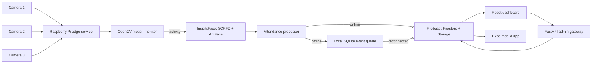

# Architecture

## Why a small FastAPI gateway is used

Firebase is the selected database/cloud service. The gateway is not a second database or general event broker. It is required only for privileged actions that must not expose a Firebase Admin credential to browsers or phones:

- face enrollment: detect a face and create an embedding;
- user deletion/update;
- admin-only system operations.

It may run on the Pi for a LAN demonstration or a small trusted server. The edge service writes directly to Firebase with its own service account because it must continue to queue and synchronize events independently of a dashboard being open.

## Multi-camera Edge behavior (1, 2, or 3 cameras)

The edge service dynamically supports 1, 2, or 3 cameras (`camera-1`, `camera-2`, `camera-3`):
- Each camera runs in its own dedicated, isolated monitor thread with OpenCV capture and a background-subtraction motion detector.
- **Dynamic Resilience**: The service runs gracefully whether 1, 2, or all 3 cameras are plugged in or configured. If any camera is missing, unplugged, or encounters a read error, its thread marks the camera as `offline` in Firestore with a diagnostic reason, and enters an asynchronous background retry loop without blocking or crashing the remaining online cameras. When reconnected, it recovers automatically.
- A short lock timeout permits sequential processing of near-simultaneous triggers from multiple cameras without frame starvation.
- For each detected face:
  1. create a normalized embedding;
  2. compare it with cached active-user embeddings by cosine similarity;
  3. record a recognized event unless that person has already checked in on that specific camera within the configured cooldown (`camera_id`, `user_id`);
  4. otherwise create an unknown event and optionally retain its image;
  5. write online or enqueue in local SQLite when Firebase is unavailable.

The user cache is refreshed periodically. Do not run two copies of the edge process against the same cameras.

## Firestore collections

| Collection | Key fields |
| --- | --- |
| `users` | `name`, `student_id`, `face_embedding`, `registration_date`, `status` |
| `attendance` | `user_id`, `name`, `camera_id`, `timestamp`, `date`, `confidence`, `status` |
| `unknown_events` | `camera_id`, `timestamp`, `image_url`, `confidence`, `recognition_status` |
| `cameras` | `camera_id`, `name`, `location`, `raspberry_pi_id`, `status`, `last_seen` |
| `system_logs` | `device_id`, `timestamp`, `event_type`, `message` |

Firestore server timestamps are used for cloud records. Every edge event also carries a UTC ISO timestamp for reliable offline replay.

## Data protection

- Service-account JSON, API keys and local event databases are excluded from Git.
- The dashboard/mobile apps use Firebase Authentication; Firestore/Storage rules deny unauthenticated access.
- Only administrators can access face embeddings. Regular authenticated clients get attendance, unknown events and device status but not embedding arrays.
- Use HTTPS when FastAPI is not confined to a trusted LAN. Keep the Pi updated and protect SSH with keys.
